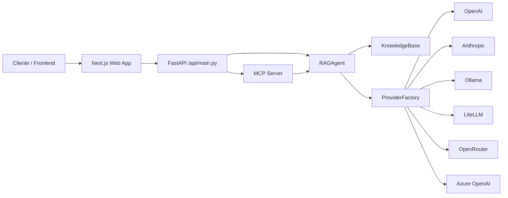

# Odin RAG MCP

O Odin nasceu para ser um ponto de partida simples, mas bem pensado, para aplicações de IA com recuperação de contexto e integração com múltiplos provedores de modelos. A ideia não é reinventar a roda, mas deixar a base organizada, clara e fácil de evoluir quando o projeto crescer.

Ele foi estruturado para ser útil tanto em protótipos quanto em ambientes mais sérios, com um backend enxuto, uma camada MCP bem definida e uma interface web direta para teste e uso prático.

## O que ele faz

- Recebe perguntas e responde com contexto recuperado
- Escolhe o provedor de IA de forma centralizada
- Expõe operações em MCP para integrações externas
- Mantém a lógica de negócio separada da camada HTTP
- Suporta múltiplos backends como OpenAI, Anthropic, Ollama, LiteLLM, OpenRouter e Azure OpenAI
- Tem controles básicos de segurança para uso em ambiente local e de prova de conceito

## Visão geral da arquitetura



## Estrutura do projeto

```text
odin-rag-mcp/
├── api/
│   └── main.py                 # Entrada HTTP da aplicação
├── apps/
│   └── web/                   # Interface em Next.js
├── config/
│   └── litellm-config.yml     # Configuração opcional do gateway de modelos
├── odin_rag_mcp/
│   ├── config.py              # Configuração central do ambiente
│   ├── mcp/
│   │   └── server.py          # Servidor MCP e ferramentas
│   ├── providers/
│   │   ├── base.py            # Contrato base para todos os provedores
│   │   ├── factory.py         # Registro e criação dos provedores
│   │   └── ...                # Implementações concretas
│   ├── rag/
│   │   ├── agent.py           # Orquestrador do fluxo RAG
│   │   └── knowledge_base.py # Busca em memória e contexto
│   └── __init__.py
├── tests/
│   └── test_security.py       # Validação de segurança e regressão
├── .env.example
├── docker-compose.yml
├── package.json
├── pyproject.toml
├── requirements.txt
├── README.md
├── LICENSE
└── .gitignore
```

## Princípios de projeto

- Encapsulamento: cada parte do sistema fica com uma responsabilidade clara
- Abstração: os provedores seguem um contrato comum
- Polimorfismo: qualquer backend de IA pode entrar no fluxo sem mexer no agente
- Inversão de dependência: o HTTP não decide a lógica da resposta
- Extensibilidade: adicionar um novo provedor ou ferramenta é simples
- Segurança por design: validação e proteção básicas já entram desde o início

## Como rodar localmente

### Backend

```bash
python -m venv .venv
source .venv/bin/activate
python -m pip install -r requirements.txt
cp .env.example .env
python -m uvicorn api.main:app --reload --host 0.0.0.0 --port 8001
```

### Frontend

Em outro terminal:

```bash
cd apps/web
npm install
npm run dev
```

### Docker Compose

```bash
docker compose up --build
```

## Segurança aplicada

O projeto já tem uma camada de segurança bem prática para uso local e de prova de conceito, com foco em reforçar a borda da aplicação:

- validação rigorosa de payloads com `pydantic`
- limite de tamanho para `question` e `context`
- CORS com origem limitada em vez de `*`
- cabeçalhos de segurança HTTP
- autenticação opcional por `X-API-Key` ou `Authorization: Bearer <token>`
- autenticação JWT real quando `JWT_SECRET` estiver configurado
- rate limiting por IP para reduzir abuso e excesso de requisições
- limite máximo de tamanho de request para evitar payloads excessivos
- auditoria de acessos com registro dos últimos eventos em `/audit`

## Variáveis de ambiente

As principais configurações ficam em `.env`:

```env
APP_NAME=Odin RAG MCP
APP_ENV=development
DEFAULT_PROVIDER=openai
ODIN_API_KEY=troque-por-uma-chave-forte
JWT_SECRET=troque-por-um-segredo-forte
JWT_ALGORITHM=HS256
LANGSMITH_API_KEY=
LANGCHAIN_API_KEY=
LANGCHAIN_TRACING_V2=true
LANGCHAIN_PROJECT=odin-rag-mcp
CORS_ALLOWED_ORIGINS=http://localhost:3000,http://127.0.0.1:3000
RATE_LIMIT_PER_MINUTE=60
RATE_LIMIT_WINDOW_SECONDS=60
MAX_REQUEST_SIZE_BYTES=1048576
MAX_QUESTION_LENGTH=2000
OPENAI_API_KEY=
OPENAI_MODEL=gpt-4o-mini
ANTHROPIC_API_KEY=
OLLAMA_BASE_URL=http://localhost:11434
LITELLM_BASE_URL=http://localhost:4000
NEXT_PUBLIC_API_URL=http://localhost:8001
```

> Se `JWT_SECRET` estiver definido, o backend passa a aceitar tokens JWT em `Authorization: Bearer ...`. Se não houver JWT, mas houver `ODIN_API_KEY`, o sistema usa a chave de API legado. Quando `LANGCHAIN_TRACING_V2=true` e existe `LANGSMITH_API_KEY`/`LANGCHAIN_API_KEY`, o projeto ativa observabilidade LangChain + LangSmith para rastrear o fluxo de prompts e respostas.

## Endpoints principais

- `GET /` — informações gerais da API
- `GET /health` — verificação de saúde
- `GET /providers` — lista os provedores ativos
- `GET /audit` — consulta os últimos eventos de acesso e auditoria
- `GET /metrics` — expõe métricas agregadas de latência e volume de requisições
- `POST /chat` — envia uma pergunta para o agente
- `POST /mcp` — executa operações MCP

Cada resposta da API inclui o cabeçalho `X-Trace-Id`, permitindo correlacionar logs, auditoria e métricas de um único fluxo de requisição.

## MCP

O servidor MCP expõe ferramentas como:

- `list_tools`
- `call_tool`
- `query`
- `ingest`
- `health`

Isso permite integrar o Odin com outros clientes sem acoplar a lógica principal à interface que o consome.

## Testes

Para verificar a parte de segurança e regressão:

```bash
python -m pip install pytest
python -m pytest tests/test_security.py -q
```

## License

MIT

## Open source e padrões abertos

O Odin é um projeto open source e pode ser usado em conformidade com padrões abertos para prototipagem, integrações internas, desenvolvimento de agentes RAG e adaptação para novos provedores de IA.

- licença: MIT
- documentação HTTP: Swagger UI em `/docs` e OpenAPI em `/openapi.json`
- interoperabilidade: protocolo HTTP REST + MCP
- extensibilidade: novos provedores podem ser adicionados sem mexer no contrato principal da aplicação
- portabilidade: pode rodar em local, container ou ambientes cloud sem reescrever a lógica de negócios

A API expõe sua interface em formato OpenAPI, o que facilita integrações automáticas, documentação, testes e adoção por outras plataformas sem depender de um lock-in de fornecedor.

## Release, deploy e uso prático

- [Release notes](docs/release-notes.md)
- [Checklist de deploy](docs/deployment-checklist.md)
- [Coleção Postman](docs/odin-rag-mcp.postman_collection.json)

## Observação final

Esse projeto foi pensado para ser um ponto de partida funcional e bem organizado, sem parecer um esqueleto genérico. A intenção é deixar claro que a arquitetura está pronta para crescer, ao mesmo tempo em que o código continua fácil de entender e manter.
